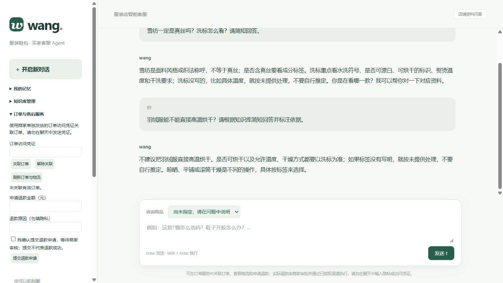

# wang · 服装鞋包买家客服 Agent

根据店铺商品资料和售后政策，回答买家的选购、尺码、材质、洗护、配送与退换货问题。保留简单聊天界面，支持多轮追问、商品选择与回答依据。

默认启动加载服装鞋包通用知识，不加载虚构商品或虚构店铺政策。配置DeepSeek密钥后可直接进行真实模型问答；导入自己的商品与政策后，可回答对应款式问题。目前支持最多100个商品资料条目；v0.9增加订单、SKU库存、物流记录及退款申请/审批/渠道执行接口。



## 启动

需要Python 3.11+：

```shell
pip install -e ".[dev]"
```

在PowerShell当前终端配置服务端环境变量：

```powershell
$env:DEEPSEEK_API_KEY = '<你的密钥>'
python -m uvicorn wang.app:app --host 127.0.0.1 --port 8000
```

打开 http://127.0.0.1:8000/ 。已有Windows用户级密钥可运行 `powershell -File start.ps1`。密钥不写入仓库或前端。未配置密钥或 `WANG_MODE=demo` 时只展示资料摘录，不伪装成模型回答。

## v0.9 订单、库存、物流与退款

详见 [统一业务接口与接入流程](docs/COMMERCE.md)。接口文档：本机启动后访问 `/docs`。买家通过左侧“订单与售后服务”关联订单和提交申请；商家接口必须配置独立 `WANG_ADMIN_TOKEN`（至少32字符），没有配置则拒绝执行。

订单访问凭证只以摘要存储，不使用可猜的订单号放行。库存事务扣减、防超卖、退款金额占用、商家审批、执行幂等键、结果不明时查询核验与操作审计已加入；聊天模型只接收裁剪后的业务状态，不能提交退款或修改库存。

`native`、`taobao`、`douyin`使用统一渠道协议。平台应用、OAuth令牌刷新、官方接口映射和真实支付网关由商家网关提供；当前尚无平台应用授权，所以只完成统一调用层与契约测试，不能声称淘宝/抖店已上线。不要把官方平台地址直接当作本项目网关URL。

管理知识库/店铺导入仍沿用本机管理入口，尚未全面做管理角色隔离；当前版本仍默认仅在本机运行。

## v0.8 常见服装知识与真实店铺导入

左侧记忆和知识库可同时展开，长内容在侧栏独立滚动；窄屏使用纵向布局，避免两个面板互相遮挡。

内置通用知识覆盖33个主题：T恤/Polo、衬衫/雪纺、卫衣、针织、羊毛羊绒、棉麻及化纤、真丝、牛仔裤、西裤、裙装、外套、羽绒服、运动服、内衣家居服、童装、鞋包、测量选码、色差透光、洗标、洗晒熨烫、起球缩水、污渍异味、辅料、配送与售后等。它是自编客服基础资料与核验清单，不是实际店铺的完整商品目录，也不保证覆盖所有品类或问题。具体成分、价格、库存、承诺和尺码必须来自店铺资料。

首次接入店铺：

1. 按 [店铺接入说明](docs/SHOP-IMPORT.md) 整理真实商品、尺码和政策。
2. 展开“知识库管理”，选择店铺JSON，点击“保存店铺与商品”。完整替换当前商品目录与政策，保存到SQLite；刷新页面并开启新对话生效。
3. 将更长的客服资料按“店铺通用”或指定商品导入TXT/Markdown。更换店铺时请检查已有导入文档是否仍适用，目录替换不会自动移除这些文档。

不知道的参数应补问或说明未提供，不能用通用知识编造款式信息。空店铺模板可导入，但不会生成真实商品。

## v0.7 记忆与接待规划

左侧“我的记忆”可填写、查看、覆盖修改及清除四项偏好：版型、颜色、材质、回答风格。只有点击保存或导入才进入长期记忆；聊天不会自动永久保存偏好或身体尺寸。简单格式检查不能识别所有隐私，请只填写必要偏好。

- 短期记忆：当前会话最近最多8轮，问答正文合计最多16000字符；较早内容从最近20轮中提取最多4条用户原话截断摘录，不把模型旧答案当成事实。这不是完整语义总结，也不能保证无限长对话的事实保留。
- 长期记忆：SQLite持久化的主动保存偏好，与当前对话分开；开启新对话不清空。使用独立HttpOnly Cookie区分浏览器，Cookie有效期30天；清Cookie或更换设备不能自动识别同一顾客，暂无账号跨端同步。
- 外置记忆：导出版本化JSON再导入，可在另一个浏览器或安装中迁移偏好。只含四项偏好，不包含身份令牌、知识库或聊天记录；导入会完整替换当前偏好。不是云端记忆服务或外部向量数据库。

顾客偏好与店铺知识库严格区分；偏好不能覆盖商品事实和售后政策，本轮明确要求优先于历史偏好。清除偏好不会删除已有聊天和已导出文件，若需避免旧对话影响，请同时开启新对话。

接待规划是独立的`planner.py`规则模块：识别多种咨询意图、关联当前商品、检查缺失测量/收货/使用信息、标记外部核验需求，生成答复步骤与策略，再连同检索资料送给模型。API返回`plan`便于开发者检查；不在买家聊天中展示内部步骤。它是可测试的初版规则规划器，不是已经过专业评测的通用自主规划系统，可能误判口语与时间表达。

偏好会随请求送到配置的模型服务；不需要时可清除。正式多顾客上线必须换成可信身份与权限隔离；当前匿名浏览器记忆不适合直接作为商家客户身份。

## v0.6 知识库与RAG

页面左侧展开“知识库管理”，选择UTF-8的TXT或Markdown文件，再选择“店铺通用”或指定商品，点击“导入并建立索引”。自动切分为850字以内片段，重叠150字，保存到当前SQLite；后续提问立即生效，无需重启。相同标题、正文和适用范围自动去重。

检索采用本地BM25关键词评分、中文二元词片段、少量客服同义表达和最近问题上下文；不是向量检索。商品专属资料只会进入对应商品的候选结果。每次最多取4段送给模型，返回资料引用；无法命中或资料冲突时应补问/说明待核验。不能保证所有口语和同义表达都能命中。

每份正文最多10万字，浏览器文件最多400KB，导入最多100份。可移除导入文档，原文件与已有聊天不删除。只支持TXT/Markdown，暂不支持PDF、Word、扫描件和自动抓取网站。资料导入后本地索引，模型回答时会将命中片段发送到所配置模型服务。

管理入口供本机店主使用，和聊天页面在同一应用中，没有管理员角色隔离，不能把此版本直接公开给买家使用。正式上线前应拆分管理权限。资料引用不能替代事实复核；旧对话仍含历史回答，新规则更新后建议开启新对话。

客服语气增加简洁回应、情绪理解和必要补问，避免反复套话与无依据承诺。效果仍依赖具体资料和模型，需要持续评测。

## 可以咨询

- T恤是什么面料、尺码怎么选、能不能烘干？
- 脚长260毫米，这款鞋的尺码表对应几码？
- 帆布包是真皮吗、能否放14寸电脑？
- 尺码不合适、色差、清洗后缝线开裂、鞋子开胶怎么办？
- 能否退换、需要核验什么、如何在原渠道联系人工？

资料没有写明的参数、缩水率、保修时长、优惠、运费责任等应明确待核验。身高体重不能保证服装合身，包袋外部尺寸不能保证电脑适配。质量问题与无理由退货分开核对，不自动承诺或拒绝售后资格。

## 换成你的店铺资料

推荐使用页面导入。也可复制 `docs/shop-template.json` 到自己的资料目录，填写实际店铺与商品资料，设置下面的环境变量。`wang/shops/demo.json` 仅作为明确标注的测试示例，默认不加载。资料应为可公开给买家的内容。

```powershell
$env:WANG_SHOP_FILE = 'D:\shop-notes\shop.json'
```

环境文件方式重启生效，优先于数据库配置；设置后页面导入会被拒绝，避免两个来源相互覆盖。JSON字段说明：

- 店铺：`name`、`is_demo`、`policies`、`products`。
- 商品：唯一 `id`、`name`、`aliases`、可选整数分 `price_cents`、`specs`、`faq`、`after_sales`。
- `specs`、`faq` 和 `policies` 是文字键值对。未提供的信息留空，不填猜测内容。
- 商品别名应能区分款式；重名或多款比较不会自动保留单个商品。
- 商品价格是资料价，不代表实时库存和成交价；动态数据需要后续授权接口。

无效配置会在启动时失败；负数或字符串价格、重复商品ID等会被拒绝。可通过 `WANG_KNOWLEDGE_DIR` 添加UTF-8 Markdown客服参考资料，但不能让通用接待方法覆盖商品和店铺事实。程序每目录最多读取100份、每份100KB以内、第一层 `.md` 文件，跳过符号链接。

商品提及优先于下拉框旧选择；未提及时沿用指定商品。API省略 `product_id` 可沿用上轮商品，传空字符串表示不指定。比较多商品后不擅自固定一款。仍需通过实际问答评测检查别名歧义与模型幻觉。

## 功能边界与数据

v0.9支持本地业务台账与授权商家网关。自建商城可登记已支付订单、扣减SKU库存和录入物流；买家用订单访问凭证关联后查询状态、申请退款，商家使用独立鉴权接口审批及执行。淘宝、抖店预留相同网关协议，尚未做官方直连与授权联调。没有网关时不产生真实支付退款，也不会查询到平台实时数据。仍无平台消息接入、自动打单、照片识别或真人转接。

聊天采用匿名Cookie隔离，SQLite默认 `data/wang-support.db`，与旧行业问答数据库分开。开启新对话不删除旧记录。模型模式会把当前问题、选中的商品和店铺资料、检索片段及最近八轮模型问答发送到配置的模型服务；页面恢复最近二十轮。关联订单后，裁剪的商品明细、金额、订单/物流/退款状态和库存也会送到模型，不发送访问凭证、支付参考号或运单号。不要输入完整订单号、手机号、地址、支付信息等隐私。

支持 `DEEPSEEK_BASE_URL`、`DEEPSEEK_MODEL`、`WANG_MODE`、`WANG_QA_DB`、`WANG_SHOP_FILE`、`WANG_KNOWLEDGE_DIR`。环境文件不自动加载。

默认本机127.0.0.1使用，无登录体系；来源/客户端头检查、纯文本输出和单并发生成不能替代生产认证、HTTPS、预算限制、租户隔离与资料治理。引用标识有效不代表事实正确，模型仍可能误判，需要人工抽检。

## 验证和开源

```shell
python -m pytest -q
ruff check .
node --check wang/static/app.js
```

测试和实测说明见 [evals/REPORT.md](evals/REPORT.md)。提供MIT License与GitHub Actions；源码仓库为 [wht26/dianshang-agent](https://github.com/wht26/dianshang-agent)。发布前检查文件不包含密钥、顾客资料和数据库。

核心文件：`shop.py` 校验商品与政策、`agent.py` 客服回答、`knowledge.py` 接待参考检索、`store.py` 对话历史、`app.py` HTTP接口、`static/` 聊天页面。
